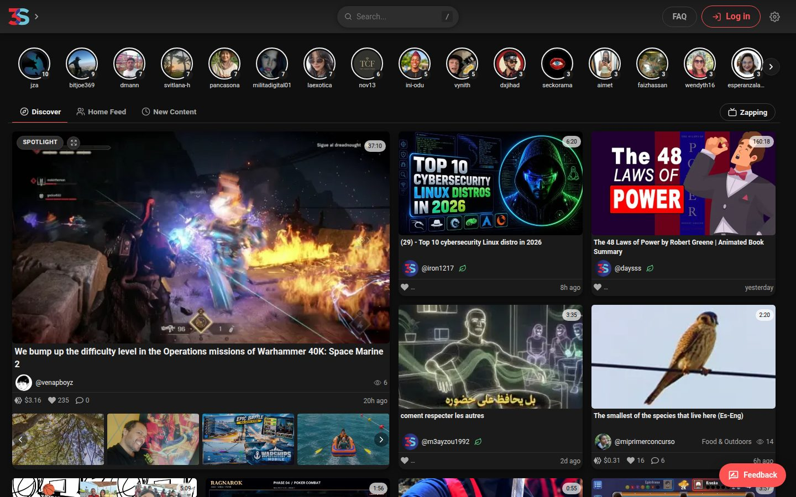
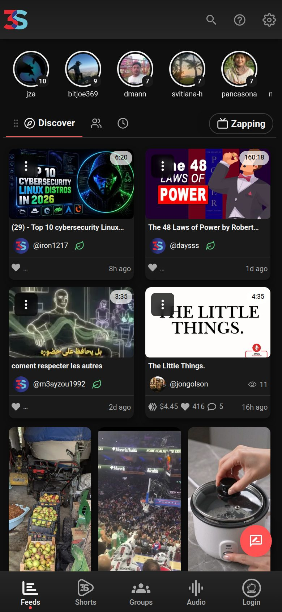
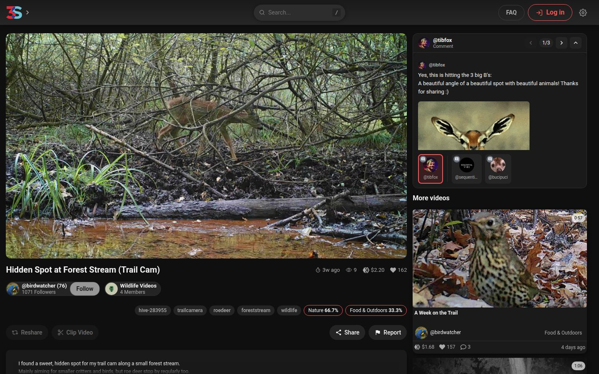
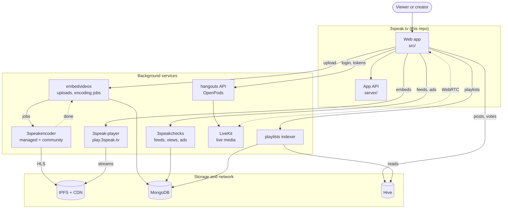

<p align="center">
  
</p>

<h1 align="center">3Speak</h1>

<p align="center">
  <strong>The video platform where creators own their channel and viewers earn too.</strong><br>
  Videos, Shorts, audio, playlists and live streams on <a href="https://hive.io">Hive</a>, the community-owned social network.
</p>

<p align="center">
  <a href="https://3speak.tv"><b>3speak.tv</b></a> ·
  <a href="#features">Features</a> ·
  <a href="#getting-started">Getting started</a> ·
  <a href="#how-it-ships">How it ships</a> ·
  <a href="#contributing">Contributing</a>
</p>

<p align="center">
  
</p>

This repository is the web app behind [3speak.tv](https://3speak.tv): a React single-page app plus a small Node API that signs, proxies and renders share cards. Every video is a Hive post owned by its creator, so votes, tips and ad revenue go straight to the creator's own account.

## Features



**Watching**
- Home with a **Discover Spotlight**, following feed, new videos, trending, tags and a "new from people you follow" row
- **Zapping** (`/surf`): TV-style channel surfing through topics
- Watch page with hover and scrub previews, a "most replayed" graph, hold-to-speed-up, keyboard shortcuts, autoplay countdown and a mini player
- Subtitles in the viewer's language, a searchable **Transcript** tab, and one-click title translation
- **Video Timeline**: chapters from description timestamps, chapter names on the progress bar, and links that pop up during playback
- **Video reactions**, watch history, leaderboards, and hiding watched videos or creators you don't want to see

**Shorts**
- Vertical feed (`/shorts`) and a Stories view, up to 2 minutes per Short
- Remix modes: Stitch, Reaction and Free edit

**Audio**
- Audio page (`/audio`) for songs, podcasts and voice messages, with a player that keeps going while you browse
- **Audio Shorts** (voice memos with covers), album uploads with per-track covers, and pay-per-listen

**Creating**
- Uploader (`/embed-studio`) with resumable uploads, scheduled posts, community picker, beneficiaries and a channel trailer
- **Shorts Editor**: teleprompter that follows your voice, green screen, music library with song credits, moving stickers, auto-cut, beat sync, sound effects, and saved drafts
- Edit after publishing (`/editvideo`): details, chapters and links, or replace the video file while keeping votes and payout
- Import from YouTube, TikTok, BitChute, Rumble and Instagram after verifying the account is yours
- Creator stats: retention, most replayed moments, audience

**Playlists and podcasts**
- Playlists with a playlist bar on the watch page
- Podcast-ready RSS feeds per channel (`/rss/<user>.xml`) and per playlist

**Ads that pay creators and viewers**
- Self-serve booking at `/advertise`: video spots, player banners, Shorts spots, pre-upload spots and scrolling tickers, paid in HIVE or HBD
- **Creators get 50%** of ad revenue, **viewers who opt in get 10%**, paid in the same currency the advertiser used
- Creators can switch video ads off per video or for the whole channel; Pro subscribers watch ad-free and still earn
- Details: [docs/ADVERTISING.md](docs/ADVERTISING.md)

**Live** (OpenPods)
- Live streams and audio rooms built on LiveKit, Stream Studio, go live from OBS with chat and overlay docks, stream pre-rolls and recordings

**Community and earning**
- Upvotes, tips and a **Supporters** tab, comment sorting, pinned comments, GIFs, images and previews
- Hive communities and badges, creator link pages (`/links/<user>`), notifications with web push
- **3Speak Chat**: direct messages and channels
- Wallet with HIVE and HBD, 3Speak Pro subscription

**Accounts**
- Log in with Hive Keychain, HiveAuth, HiveSigner, PeakVault, Ledger or Butter Auth
- Start without a Hive account: warm-up accounts and invite links

**Everywhere**
- 21 languages, translated by the community at `/translate` (see [TRANSLATING.md](TRANSLATING.md))
- Installable PWA with app shortcuts, and native app builds via Capacitor
- Embeddable player, an oEmbed endpoint and rich share cards for Discord, X and other apps

<p align="center">
  
</p>

## Tech stack

| Area | Used |
|---|---|
| UI | React 19, React Router 7, SCSS |
| Build | Vite 8, vite-plugin-pwa, Capacitor 8 for the native apps |
| State and data | Zustand, TanStack Query (plus a small legacy Redux store) |
| Player | [`@mantequilla-soft/3speak-player`](https://github.com/Mantequilla-Soft/3speak-player) (HLS) |
| Hive | `@hiveio/dhive`, `@hiveio/content-renderer`, Aioha, Keychain SDK, HiveAuth |
| Live | LiveKit, [`@snapie/hangouts-*`](https://github.com/Mantequilla-Soft/hangouts) |
| Uploads | tus resumable uploads to [embedvideos](https://github.com/Mantequilla-Soft/embedvideos) |
| i18n | i18next, 21 languages |
| API (`server/`) | Node + Express 5: login sessions, signing, share cards, oEmbed, imports, translation editor |

## Getting started

You need **Node.js 22** and npm.

```bash
git clone https://github.com/Mantequilla-Soft/new-3speak-tv.git
cd new-3speak-tv
npm install
cp .env.example .env      # then fill in the values you need
npm run dev               # http://localhost:5173
```

`.env.example` lists the variables with a comment for each. The main groups:

| Group | Examples |
|---|---|
| Core APIs | `VITE_API_URL_FROM_WEST`, `VITE_CHECKER_URL`, `VITE_SITE_URL` |
| Player and media | `VITE_PLAYER_URL`, `VITE_APP_VIDEO_CDN_DOMAIN`, `VITE_PLAYLISTS_API_URL` |
| Uploads and editor | `VITE_EMBED_UPLOAD_URLS`, `VITE_EMBED_API_URL`, `VITE_EDITOR_URLS` |
| Hive nodes | `VITE_HIVE_API_URL`, `VITE_HIVE_API_FALLBACKS` |
| Feature switches | `VITE_ENABLE_BUTRAUTH`, `VITE_ENABLE_PPL`, `VITE_ENABLE_CAMERA_RECORD`, `VITE_FEATURE_EDITOR` |
| Live | `VITE_HANGOUTS_API_URL`, `VITE_LIVEKIT_URL` (leave unset to turn live features off) |

The API in `server/` is optional for browsing. It has its own `server/.env.example`; start it with `node server/index.cjs`.

### Scripts

| Command | What it does |
|---|---|
| `npm run dev` | Dev server with hot reload |
| `npm run build` | Production build into `dist/` |
| `npm run preview` | Serve the production build locally |
| `npm run lint` | ESLint |
| `npm run i18n:check` | Check every language for missing or broken keys |
| `npm run i18n:translate` | Machine-translate missing keys (needs `ANTHROPIC_API_KEY`) |

### Known issue

`@snapie/hangouts-react` is currently pinned to a local build (0.26.7) that is not on npm yet, so `npm install` stops at that package on a fresh clone. This goes away once that version is published.

## Project structure

```
src/
├── App.jsx          routes
├── page/            one component per route
├── components/      feature folders (playVideo, embed-studio, openpods, ads, Chat, Wallet, ...)
├── hooks/           playback, ads, live streams, teleprompter, watch history
├── lib/             Zustand store and slices, ads, supporters, video data
├── hive-api/        Aioha setup and Hive API helpers
├── utils/           helpers (Hive nodes, uploads, timeline, push, PWA)
├── i18n/ locales/   i18next setup and the 21 languages
├── changelog.js     the "We shipped an update" entries users see
└── version.js       APP_VERSION
server/
├── index.cjs        the API (auth sessions, signing, uploads, editor tokens, playlists proxy)
├── og-*.cjs         share cards, oEmbed, Discord video teasers, sitemaps
├── i18n-editor.cjs  the community translation editor
└── *import*.cjs     imports from other video platforms
docs/                advertising, upload API notes, screenshots
```

## How it ships

- `develop` is where work lands. [preview.3speak.tv](https://preview.3speak.tv) runs it.
- A pull request from `develop` into `production` is the release. Merging it deploys 3speak.tv automatically ([deploy-production.yml](.github/workflows/deploy-production.yml)): the server builds the release itself, waits for running uploads to finish, swaps the site, smoke-tests it and swaps back if anything fails.
- User-facing changes get a short entry in `src/changelog.js` and a version bump in `src/version.js`, which shows returning users the "We shipped an update" popup.
- Translation changes are checked by [i18n.yml](.github/workflows/i18n.yml).

## Contributing

Issues and pull requests are welcome. The full guide is in [CONTRIBUTING.md](CONTRIBUTING.md).

1. Fork the repo and branch off `develop` (`feat/...`, `fix/...`, `docs/...`).
2. Use [Conventional Commits](https://www.conventionalcommits.org/) (`feat:`, `fix:`, `docs:`, `chore:`).
3. New UI text goes through i18next and needs a key in every language: run `npm run i18n:check`.
4. Open the pull request against `develop`.

Fixing a translation is one of the most useful things you can do: see [TRANSLATING.md](TRANSLATING.md).

## Related projects

| Project | What it is |
|---|---|
| [3speak-player](https://github.com/Mantequilla-Soft/3speak-player) | The video player |
| [embedvideos](https://github.com/Mantequilla-Soft/embedvideos) | Upload and embed service other Hive apps can use too |
| [3speakencoder](https://github.com/Mantequilla-Soft/3speakencoder) | Community video encoder |
| [hangouts](https://github.com/Mantequilla-Soft/hangouts) | OpenPods: live streams and audio rooms |
| [snapieaudio](https://github.com/Mantequilla-Soft/snapieaudio) | Audio hosting and player |
| [3speakchecks](https://github.com/Mantequilla-Soft/3speakchecks) | Feeds, views and ads API |

## How the services fit together

This repo is the web app and its small API. Uploads, encoding, feeds, playlists and live rooms run as separate services:



- **Uploading:** the app sends the file to embedvideos in resumable chunks. An encoder picks up the job, either pushed to a 3Speak-run encoder or polled by a community encoder, writes the HLS renditions to IPFS and reports back. The creator's post then goes to Hive.
- **Watching:** the player streams the HLS files from IPFS through the CDN. Feeds, view counts and ads come from 3speakchecks.
- **Playlists** are Hive `custom_json` operations. The indexer reads them back and serves them to the app.
- **Live:** the hangouts API checks your Hive signature and hands out a LiveKit token. Audio and video then flow directly between your browser and LiveKit (OBS can join over WHIP).

## License

[MIT](LICENSE)

## Links

[3speak.tv](https://3speak.tv) · [Discord](https://discord.gg/NSFS2VGj83) · [X](https://x.com/3speaktv) · [@threespeak on Hive](https://ecency.com/@threespeak)

<p align="center">
  Built by the 3Speak team and contributors<br>
  @kesolink · @menobass · @eddiespino · @tibfox
</p>
